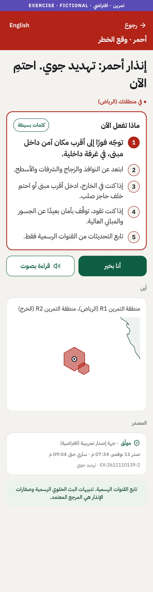
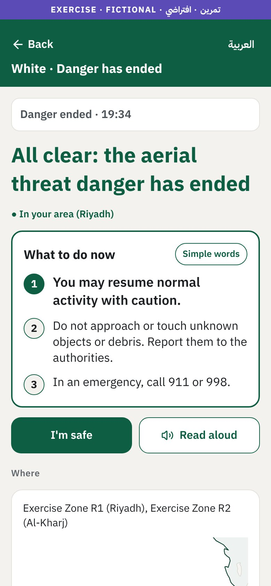
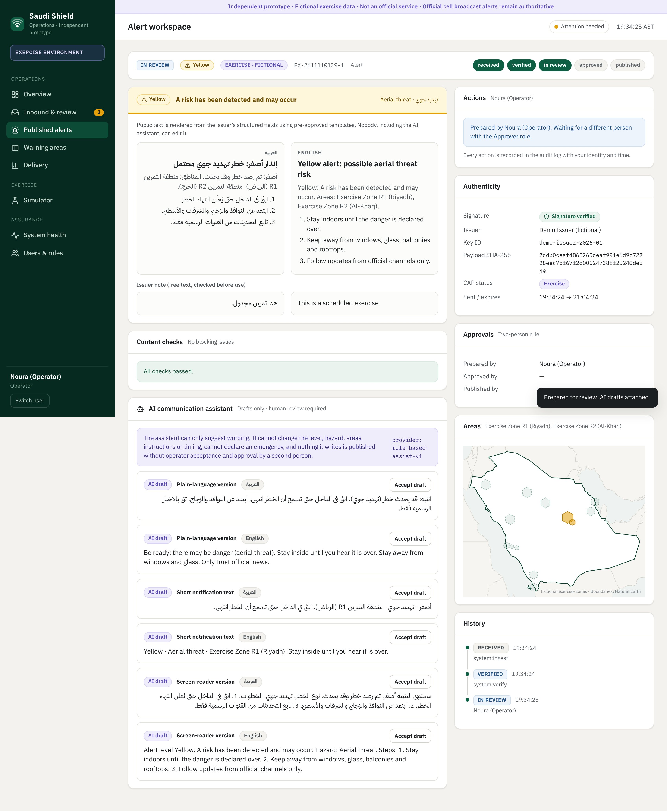

# Saudi Shield · independent prototype

> **Independent prototype · Fictional exercise data · Not an official service.**
> Not affiliated with, endorsed by, or operated by any Saudi government entity. All alerts, areas, people and statistics are synthetic and fictional. Official cell broadcast alerts and sirens remain authoritative.

Saudi Shield is a working prototype of a multilingual civilian emergency-warning *companion* platform. It shows how verified alerts from authorised issuers, approved warning areas, accessible safety guidance and voluntary family check-ins could improve civilian preparedness, if formally integrated with authorised systems such as the National Early Warning Platform.

It does **not** track, predict or assess any threat, and it cannot originate a warning. See [safety boundaries](docs/05-safety-boundaries.md).

| Civilian app (Arabic) | Civilian app (English) | Operations dashboard |
|---|---|---|
|  |  |  |

## What it demonstrates

* **Verified alerts only.** Issuer messages are Ed25519-signed; tampered, unknown-key, non-exercise or malformed messages are quarantined. The app verifies every alert with a pinned key and hides anything forged.
* **Human approval.** An operator prepares, a *different* approver approves, a duty publisher publishes. Six roles, one permission table shared by API and UI. Every action goes into a hash-chained audit log.
* **AI that assists, never decides.** The assistant drafts plain-language, short and screen-reader versions and translates notes from an approved phrasebook. It cannot change level, area, instructions or timing, and a checker blocks speculative or conflicting wording.
* **Clear public experience.** Arabic (RTL) and English, the official Yellow / Red / White meanings, numbered steps, read-aloud, plain-language mode, high contrast and large text, offline guidance, family "I'm safe" check-ins, emergency numbers, and a data-saver feed.
* **A safe simulator.** Fictional scenarios show the full life of a warning: received, verified, reviewed, issued, displayed and cleared, plus integrity failures and unclear content.

## Repository

```
docs/            research, architecture, UX spec, roadmap, safety boundaries, testing, presentation
packages/core    shared TypeScript domain library (31 tests)
apps/api         NestJS API and simulator (15 end-to-end tests)
apps/dashboard   Next.js operations dashboard
apps/mobile      Expo / React Native civilian app
db/schema.sql    PostgreSQL + PostGIS reference schema
scripts/         demo journey (Playwright), accessibility scan (axe-core), map data generator
```

## Run the demo

Requires Node 22 and pnpm 10.

```bash
pnpm install
pnpm --filter @saudi-shield/core build

# 1. API on :4000 (seeds a little fictional history; SEED=0 to start empty)
pnpm --filter @saudi-shield/api dev

# 2. Dashboard on :3000
pnpm --filter @saudi-shield/dashboard build && pnpm --filter @saudi-shield/dashboard start

# 3. Civilian app on :8081 (web build of the React Native app)
pnpm --filter @saudi-shield/mobile export:web && npx serve -l 8081 apps/mobile/web-build
#    or run it on a phone with Expo Go: pnpm --filter @saudi-shield/mobile start
```

Open the dashboard, sign in as **Noura (Operator)**, go to **Simulator** and send the first step of *Aerial threat drill*. Open the workspace, prepare it, then **Switch user** to **Huda (Approver)** to approve and **Sara (Duty publisher)** to publish. The app at `http://localhost:8081` shows the alert within seconds.

Useful app URL parameters for demos: `lang=ar|en`, `city=RIY-RIYADH`, `onboarded=1`, `demo=device` (self-contained demo data, no API), `offline=1`, `lite=1` (data saver), `hc=1` (high contrast), `scale=1.3`.

### Tests

```bash
pnpm --filter @saudi-shield/core test
pnpm --filter @saudi-shield/api test
node scripts/demo-journey.cjs     # full UI journey + screenshots (servers above must be running)
node scripts/a11y-check.cjs       # accessibility scan
```

## Public website (`apps/web`)

A free, bilingual preparedness site for everyone in the Kingdom. It is clearly independent, sends no live alerts and uses only fictional exercise data.

- **Prepare**: before, during and after guidance for six hazards, printable.
- **Family plan and go-bag**: safe rooms, meeting points and contacts on one printable card, plus a 14-item checklist. Saved only in the browser.
- **Is it real?**: a five-question check for forwarded "alerts", and a live demo of how a signed message fails when altered.
- **Try a drill**: runs the real `core` pipeline in the browser (signature check, preparer, a different approver, a third publisher, phone-side verification) and shows a forged message being quarantined.
- **Numbers**: 911, 998, 997 and 999 with tap to call.
- Arabic and English with right-to-left layout, larger text and high-contrast modes, offline support through a service worker, no accounts, analytics or location.

```bash
pnpm --filter @saudi-shield/core build
pnpm --filter @saudi-shield/web build          # static export in apps/web/out
python3 -m http.server 3100 -d apps/web/out    # or any static host
pnpm web:check                                 # 11 browser checks + axe scan, screenshots in docs/screenshots/web
```

## Milestones

| Milestone | Status | Where |
|---|---|---|
| 1 · Research and architecture | Done | [01 research](docs/01-research.md), [02 architecture](docs/02-architecture.md), [03 UX spec](docs/03-ux-spec.md), [04 roadmap](docs/04-roadmap.md), [05 safety](docs/05-safety-boundaries.md) |
| 2 · Interactive prototype | Done | `apps/mobile`, `apps/dashboard`, [screenshots](docs/screenshots) |
| 3 · Simulation environment | Done | `apps/api`, dashboard **Simulator** page, `packages/core/src/scenarios.ts` |
| 4 · Family and accessibility | Done | Family tab, read-aloud, plain language, high contrast, offline guidance, data-saver feed |
| 5 · Testing and validation | Done | [06 testing](docs/06-testing.md) |
| 6 · Presentation package | Done | [presentation](docs/presentation) |

## Naming and branding

"Saudi Shield" is a working title. Because it could be mistaken for an official service, it must not be used publicly (app stores, public URLs) without the relevant authority's approval. The prototype uses an independent abstract mark and no government emblems.
